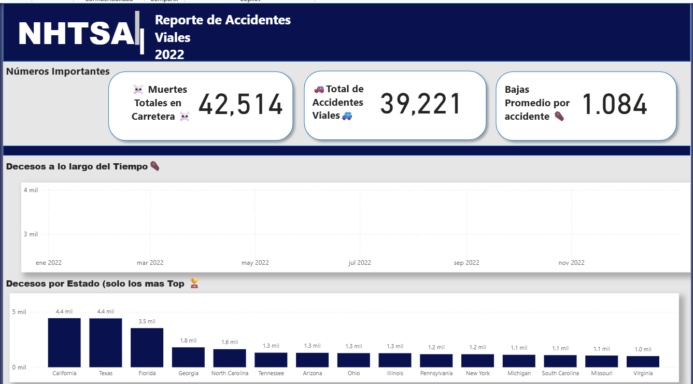
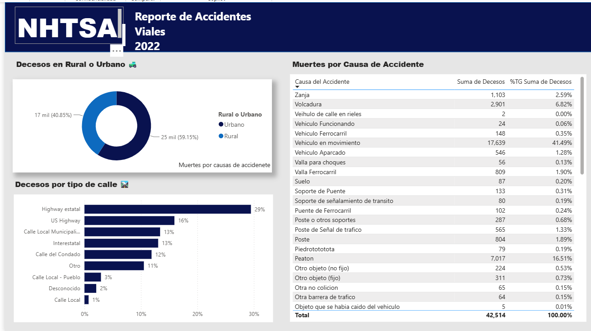

# 🚗 ¡Manejar es peligroso! — Accidentes Viales Fatales en EE. UU. 2022

> **42,514 muertes** en accidentes viales en un solo año. ¿Dónde, cuándo, cómo y a quién afectan más?


Proyecto de análisis y visualización de datos en **Power BI** con la base pública de la **NHTSA** (National Highway Traffic Safety Administration) sobre accidentes fatales ocurridos en 2022. Incluye modelado de datos, medidas en **DAX** y tres dashboards: uno narrativo, uno de números clave y uno de rutas y causas.

---

## 🎯 Objetivo

Identificar qué factores (ubicación, tipo de vía, momento del año, perfil de las víctimas y causa del accidente) concentran más muertes viales en Estados Unidos, y presentar los hallazgos de forma clara para la toma de decisiones.

## 🔎 Hallazgos principales

| # | Hallazgo | Dato |
|---|---|---|
| 1 | **Escala del problema** | 42,514 muertes en 39,221 accidentes (≈ 1.08 muertes por accidente) |
| 2 | **Estados con más muertes (cifras absolutas)** | California y Texas (4.4 mil cada uno) y Florida (3.5 mil) |
| 3 | **Estados más peligrosos por habitante** | Mississippi (23.74), Wyoming (23.23) y New Mexico (22.01) por cada 100,000 habitantes; el promedio nacional es **12.70** |
| 4 | **Peligro desproporcionado en estados desérticos y del "viejo sur"** | Mississippi, South Carolina, Arkansas, Alabama y Louisiana están entre los 8 primeros en tasa por habitante |
| 5 | **Las carreteras principales concentran las muertes** | Highway estatal: 29 % · US Highway: 16 % · Interestatal: 13 % (el mapa de calor muestra más concentración en el sur) |
| 6 | **Zona urbana vs. rural** | 59.15 % urbano (25 mil) · 40.85 % rural (17 mil) |
| 7 | **Principales causas** | Choque con vehículo en movimiento (41.49 %), peatones (16.51 %) y volcaduras (6.82 %) |
| 8 | **Perfil de las víctimas** | 30.67 mil hombres frente a 11.74 mil mujeres (las mujeres son ≈ 28 % de las víctimas con sexo registrado) |
| 9 | **Estacionalidad** | **Octubre** es el mes más letal; curiosamente el invierno no genera más muertes |

> 💡 **Contraste clave:** California y Texas lideran en número de muertes por su población, pero **no aparecen entre los estados más peligrosos por habitante**. Medir por cada 100,000 habitantes cambia por completo la conclusión.

## 🖼️ Vista del proyecto

### Dashboard NHTSA Final — la historia


### Rutas y causas de los accidentes


### Reporte de Accidentes Viales 2022 — números importantes


## 🗂️ Estructura del reporte

| Página | Contenido |
|---|---|
| **Dashboard NHTSA Final** | Mensaje principal: total de muertes, distribución por sexo, mapa de calor, mes más letal y ranking de estados por muertes por 100,000 habitantes |
| **Reporte de Accidentes Viales 2022** | KPIs (muertes totales, total de accidentes y promedio por accidente), decesos a lo largo del tiempo y top de estados |
| **Rutas y causas** | Muertes en zona rural vs. urbana, por tipo de calle y por causa del accidente |
| **Análisis exploratorio** | Exploración inicial por estado, fecha, clima, tipo de calle y autobuses escolares |
| **Páginas de apoyo** | Tablas de apoyo con motocicletas, adultos de 65+, tiempo de reacción promedio, acumulado del año y cambio mes vs. mes |

## 🧱 Modelo de datos

Modelo con tablas de hechos y dimensiones:

- **Hechos:** `Accidentes USA 2022`, `Personas Accidentes 2022`
- **Dimensiones y apoyo:** `FECHA`, `Poblacion de Estados`, `Auxiliar Accidentes USA 2022`


## 🧮 Medidas DAX destacadas

> ✏️ *Reemplaza estos ejemplos con tu código real.*

```DAX
Decesos Totales = SUM ( 'Accidentes USA 2022'[Decesos] )

Muertes por 100000 habitantes =
DIVIDE ( [Decesos Totales], SUM ( 'Poblacion de Estados'[Poblacion] ) ) * 100000

Muertos hasta la fecha =
TOTALYTD ( [Decesos Totales], 'FECHA'[Fecha] )

Cambio MesVsMes Muertos % =
VAR MesActual = [Decesos Totales]
VAR MesPasado = CALCULATE ( [Decesos Totales], PREVIOUSMONTH ( 'FECHA'[Fecha] ) )
RETURN DIVIDE ( MesActual - MesPasado, MesPasado )
```

## 🛠️ Herramientas y habilidades

- **Power BI Desktop** — dashboards y visualización
- **Power Query** — limpieza y transformación de datos
- **DAX** — medidas, inteligencia de tiempo y métricas per cápita
- **Modelado de datos** — tablas de hechos, calendario y dimensiones
- **Storytelling con datos** — títulos y mensajes que explican cada gráfico

## 📁 Contenido del repositorio

```
├── nhtsa_accidentes_2022.pbix   # Reporte de Power BI
├── imagenes/                    # Capturas de los dashboards
└── README.md
```

## ▶️ Cómo abrirlo

1. Descarga `nhtsa_accidentes_2022.pbix`.
2. Ábrelo con [Power BI Desktop](https://powerbi.microsoft.com/desktop/) (gratuito, solo Windows).
3. Explora las páginas y usa los filtros.

## 📚 Fuente de datos

- NHTSA — *Fatality Analysis Reporting System (FARS)*, 2022: <https://www.nhtsa.gov/research-data/fatality-analysis-reporting-system-fars>
- Población por estado: *[agrega tu fuente, p. ej. U.S. Census Bureau]*

## 👤 Autor

**[Abraham Garcia]** — [LinkedIn](www.linkedin.com/in/abrahamgarcia-ing) · 

⭐ Si te resultó útil, deja una estrella al repositorio.
